<div align="center">

<a href="https://github.com/Mar7thDev/March7thHoney"></a>

[Quick start](#quick-start) · [Features](#features) · [Documentation](docs/README.md) · [Contributing](CONTRIBUTING.md) · [Discord](https://discord.gg/CyreneEchoes)

<a href="https://github.com/Mar7thDev/March7thHoney/actions/workflows/ci.yml"></a>
<a href="https://github.com/Mar7thDev/March7thHoney/stargazers"></a>
<a href="https://discord.gg/CyreneEchoes"></a>

English | [简体中文](docs/project-overview/README.zh-CN.md) | [繁體中文](docs/project-overview/README.zh-TW.md) | [日本語](docs/project-overview/README.ja-JP.md)

</div>

<table>
<tr>
<td width="50%" valign="top">

### 🎮 Playable end to end

Shops, warps, battles, the open world and the endgame challenge modes work against a real client; missions are being filled in.

</td>
<td width="50%" valign="top">

### 🚀 Built to be run

SQLite or MySQL, a web admin panel, the MUIP API and a systemd-ready Linux setup. Windows, Linux and macOS on `x64` and `arm64`.

</td>
</tr>
<tr>
<td width="50%" valign="top">

### ⚡ No reflection at run time

Packet handlers, commands and database stores are registered by Roslyn source generators, so the server also publishes with NativeAOT.

</td>
<td width="50%" valign="top">

### ✅ Checked on every change

A warnings-as-errors build and the regression suites for accounts, the web server, KCP and the source generators run in CI; more suites cover login, scenes and game modes against real resources.

</td>
</tr>
</table>

## Features

| Module | Status | Notes |
|---|---|---|
| Shop system | Stable | Browse and purchase flow works |
| Team formation | Stable | Lineup and slot switching available |
| Warp/Gacha | Stable | Full pull flow and result display |
| Battle flow | Stable | Core combat loop is playable |
| Open-world scene | Stable | Scene loading, interaction, exploration |
| Character progression | Stable | Leveling and promotion loops available |
| Quest system | In progress | Main/common progression works, edge cases remain |
| Friend system | Stable | Core interaction and display |
| Anomaly Arbitration | Stable | Entry/challenge/reward supported |
| Challenge modes | Stable | FH / PF / AS playable |
| Currency War | In progress | Basic gameplay flow available |
| Achievement system | Stable | Most achievements supported |

The full list is in the [gameplay implementation tree](docs/development/gameplay-implementation.md).

## Quick start

You need the .NET SDK 10 (10.0.100 or later) and Git, on Windows, Linux or macOS (`x64` or `arm64`).

```bash
git clone https://github.com/Mar7thDev/March7thHoney.git
cd March7thHoney
dotnet run --project Program/Program.csproj
```

The repository does not contain game resources. The server reads them from a local resource cache; see
[rebuilding the resource cache from a client export](docs/operations/resource-cache-from-client-export.md).

For a Linux server, including a systemd service and updates, follow the
[native Linux guide](docs/getting-started/native-linux.md).

## Build

```bash
dotnet build Program/Program.csproj -c Release
```

The build generates the protocol C# from the checked-in definitions of the active protocol version, `Proto/4.7/`,
selected by `ActiveProtocolVersion` in `Proto/Proto.csproj`, using pinned `Google.Protobuf.Tools` 3.33.1. Generated
files live under `Proto/obj/` and are not tracked. Older protocol versions are kept as lossless ZIP archives in
`Proto/Archives/`. See the [protocol guide](docs/development/protobuf.md) for updating the definitions and for
platform requirements.

CI publishes self-contained builds of `main` as workflow artifacts:

| Runtime | Artifact name |
|---|---|
| `win-x64` | `March7thHoney-win-x64` |
| `linux-x64` | `March7thHoney-linux-x64` |
| `linux-arm64` | `March7thHoney-linux-arm64` |

A publish carries the configuration defaults tracked in `Config/`, including the login RSA key pair in
`Config/Security/`. The server reads `Config/` from its working directory and rejects every encrypted login when
`Config/Security/LoginRsaPrivateKey.pem` is missing. The pair is public test material shared with CyreneLauncher,
which encrypts with its public half by default, so it protects nothing on a server that others can reach. The
resource cache is not included.

[Releases](https://github.com/Mar7thDev/March7thHoney/releases) carry `win-x64.zip`, the Windows package that
CyreneLauncher downloads: the self-contained `win-x64` build that CI publishes for the release tag, with
`Config/Resource.bin` added. The launcher unpacks it over its server folder, so an update keeps `Config.json` and
`Config/Database/`.

## Documentation

The [documentation index](docs/README.md) lists everything. Starting points:

- Running a server: [native Linux guide](docs/getting-started/native-linux.md), [account security](docs/operations/account-security.md)
- APIs: [MUIP API](docs/api/muip-api.md), [web account API](docs/api/web-account-api.md)
- Working on the code: [contributing guide](CONTRIBUTING.md), [protocol](docs/development/protobuf.md), [source generators](docs/development/source-generators.md)
- Regression suites: [security gate](docs/testing/security-regression.md) and the other documents under `docs/testing/`

## Contributing

Changes are welcome. Read the [contributing guide](CONTRIBUTING.md) for the build, the regression suites to run
and the conventions for commits and pull requests. Report vulnerabilities privately as described in the
[security policy](SECURITY.md).

## Roadmap

1. Improve Currency War and Divergent Universe.
2. Fill remaining quests and special trigger logic.
3. Improve settlement/sync stability in edge cases.
4. Expand event-mode gameplay coverage.
5. Continue fixing UI and state-sync issues.
6. Add more configurable server options.

## Troubleshooting

- Check the server logs under your configured log path.
- `/scene reload` solves most scene problems.
- If behavior looks inconsistent after updating, clear the runtime cache and data and retest with a fresh account.
- Community support: <https://discord.gg/CyreneEchoes>

## Credits

### Collaborators

- [Oriha](https://github.com/OrihaWeave)
- Cyrup
- [Melioli](https://github.com/Melioli)

### Contributors

- [Yuki](https://github.com/Yuki8859)
- [Cyt](https://github.com/qinfyy)
- [Glzd001](https://github.com/Glzd001)
- [blamefire159-debug](https://github.com/blamefire159-debug)
- [AzureXuanVerse](https://github.com/AzureXuanVerse)
- [AcheronWife](https://github.com/AcheronWife)
- [Yuuki](https://github.com/akbaryahya)
- [ShuaiyuMiao](https://github.com/ShuaiyuMiao)

### Projects

- [LunarCore](https://github.com/Melledy/LunarCore)
- [DanhengServer](https://github.com/OrihaWeave/DanhengServer-OpenSource)
- [KcpSharp](https://github.com/yigolden-oss/KcpSharp)

<a href="https://github.com/Mar7thDev/March7thHoney/graphs/contributors"></a>

## Star history

<a href="https://www.star-history.com/#Mar7thDev/March7thHoney&Date"></a>

## License

March7thHoney is licensed under the [GNU Affero General Public License v3.0](LICENSE).
