<div align="center">

<a href="https://github.com/Mar7thDev/March7thHoney"></a>

[クイックスタート](#クイックスタート) · [機能](#機能) · [ドキュメント](../README.md) · [コントリビューション](../../CONTRIBUTING.md) · [Discord](https://discord.gg/CyreneEchoes)

<a href="https://github.com/Mar7thDev/March7thHoney/actions/workflows/ci.yml"></a>
<a href="https://github.com/Mar7thDev/March7thHoney/stargazers"></a>
<a href="https://discord.gg/CyreneEchoes"></a>

[English](../../README.md) | [简体中文](README.zh-CN.md) | [繁體中文](README.zh-TW.md) | 日本語

</div>

<table>
<tr>
<td width="50%" valign="top">

### 🎮 最初から最後まで遊べる

ショップ、跳躍、戦闘、オープンワールド、エンドゲームの各チャレンジモードが実際のクライアントで動作します。任務は拡充中です。

</td>
<td width="50%" valign="top">

### 🚀 運用を前提にした作り

SQLite または MySQL、Web 管理画面、MUIP API、systemd に対応した Linux 構成を備えています。Windows、Linux、macOS の `x64` と `arm64` に対応します。

</td>
</tr>
<tr>
<td width="50%" valign="top">

### ⚡ 実行時にリフレクションを使わない

パケットハンドラー、コマンド、データベースストアは Roslyn ソースジェネレーターが登録するため、NativeAOT でも発行できます。

</td>
<td width="50%" valign="top">

### ✅ 変更のたびに検証

警告をエラーとして扱うビルドと、アカウント、Web サーバー、KCP、ソースジェネレーターの回帰スイートが CI で実行されます。ログイン、シーン、各ゲームモードには実リソースを使う回帰スイートが別にあります。

</td>
</tr>
</table>

このページ以外のドキュメントは英語と簡体字中国語で提供されています。以下のリンクは英語版を指します。

## 機能

| モジュール | 状態 | 説明 |
|---|---|---|
| ショップ | 安定 | 閲覧と購入の流れが動作 |
| 編成 | 安定 | チームとスロットの切り替えに対応 |
| 跳躍/ガチャ | 安定 | 抽選の流れと結果表示が完全に動作 |
| 戦闘フロー | 安定 | 基本の戦闘ループをプレイ可能 |
| オープンワールド | 安定 | シーンの読み込み、インタラクション、探索 |
| キャラクター育成 | 安定 | レベルアップと昇格が利用可能 |
| 任務 | 開発中 | メインと共通の進行は動作、例外的なケースが残る |
| フレンド | 安定 | 基本のやり取りと表示 |
| 異相の仲裁 | 安定 | 入場、挑戦、報酬に対応 |
| チャレンジモード | 安定 | 忘却の庭、虚構叙事、末日の幻影をプレイ可能 |
| 貨幣戦争 | 開発中 | 基本のゲームフローが利用可能 |
| アチーブメント | 安定 | ほとんどのアチーブメントに対応 |

全体の一覧は[ゲームプレイ実装ツリー](../development/gameplay-implementation.md)を参照してください。

## クイックスタート

.NET SDK 10（10.0.100 以降）と Git が必要です。Windows、Linux、macOS（`x64` または `arm64`）に対応しています。

```bash
git clone https://github.com/Mar7thDev/March7thHoney.git
cd March7thHoney
dotnet run --project Program/Program.csproj
```

リポジトリにはゲームリソースは含まれていません。サーバーはローカルのリソースキャッシュから読み込みます。作成方法は[クライアントのエクスポートからリソースキャッシュを再構築する](../operations/resource-cache-from-client-export.md)を参照してください。

Linux サーバーでの運用（systemd サービスと更新を含む）は[ネイティブ Linux ガイド](../getting-started/native-linux.md)に従ってください。

## ビルド

```bash
dotnet build Program/Program.csproj -c Release
```

ビルド時に、バージョンを固定した `Google.Protobuf.Tools` 3.33.1 を使って、リポジトリ内にある有効なプロトコルバージョン `Proto/4.7/` の定義からプロトコルの C# を生成します。有効なバージョンは `Proto/Proto.csproj` の `ActiveProtocolVersion` で指定します。生成されたファイルは `Proto/obj/` に置かれ、バージョン管理の対象外です。旧バージョンのプロトコルは `Proto/Archives/` に可逆圧縮の ZIP アーカイブとして保存されています。定義の更新方法とプラットフォーム要件は[プロトコルガイド](../development/protobuf.md)を参照してください。

CI は `main` の自己完結型ビルドをワークフローの成果物として公開します。

| ランタイム | 成果物名 |
|---|---|
| `win-x64` | `March7thHoney-win-x64` |
| `linux-x64` | `March7thHoney-linux-x64` |
| `linux-arm64` | `March7thHoney-linux-arm64` |

publish の出力には、`Config/` でバージョン管理されている既定の設定が含まれます。`Config/Security/` のログイン用 RSA 鍵ペアもその一つです。サーバーは作業ディレクトリから `Config/` を読み込み、`Config/Security/LoginRsaPrivateKey.pem` がないと暗号化されたログインをすべて拒否します。この鍵ペアは CyreneLauncher と共有する公開のテスト用素材で（ランチャーは既定でその公開鍵で暗号化します）、他人がアクセスできるサーバーでは何も保護しません。リソースキャッシュは含まれません。

[Releases](https://github.com/Mar7thDev/March7thHoney/releases) には CyreneLauncher がダウンロードする Windows パッケージ `win-x64.zip` があります。CI がリリースタグに対して公開する自己完結型の `win-x64` ビルドに `Config/Resource.bin` を加えたものです。ランチャーはこれをサーバーフォルダーに上書き展開するため、更新しても `Config.json` と `Config/Database/` は残ります。

## ドキュメント

[ドキュメント索引](../README.md)にすべての文書が載っています。主な入口：

- サーバーの運用：[ネイティブ Linux ガイド](../getting-started/native-linux.md)、[アカウントセキュリティ](../operations/account-security.md)
- API：[MUIP API](../api/muip-api.md)、[Web アカウント API](../api/web-account-api.md)
- 開発に参加する：[コントリビューションガイド](../../CONTRIBUTING.md)、[プロトコル](../development/protobuf.md)、[ソースジェネレーター](../development/source-generators.md)
- 回帰テスト：[セキュリティゲート](../testing/security-regression.md)と `docs/testing/` 以下の文書

## コントリビューション

変更の提案を歓迎します。ビルド方法、実行すべき回帰テスト、コミットとプルリクエストの規約は[コントリビューションガイド](../../CONTRIBUTING.md)を参照してください。脆弱性は[セキュリティポリシー](../../SECURITY.md)に従って非公開で報告してください。

## ロードマップ

1. 貨幣戦争と階差宇宙の改善。
2. 残りの任務と特殊なトリガーロジックの補完。
3. 例外的なケースでの精算と同期の安定性向上。
4. イベントモードの対応範囲の拡大。
5. UI と状態同期の問題の継続的な修正。
6. 設定可能なサーバーオプションの追加。

## トラブルシューティング

- 設定したログディレクトリのサーバーログを確認してください。
- `/scene reload` でほとんどのシーンの問題が解決します。
- 更新後に動作がおかしい場合は、ランタイムのキャッシュとデータを消去し、新しいアカウントで再確認してください。
- コミュニティサポート：<https://discord.gg/CyreneEchoes>

## クレジット

### コラボレーター

- [Oriha](https://github.com/OrihaWeave)
- Cyrup
- [Melioli](https://github.com/Melioli)

### コントリビューター

- [Yuki](https://github.com/Yuki8859)
- [Cyt](https://github.com/qinfyy)
- [Glzd001](https://github.com/Glzd001)
- [blamefire159-debug](https://github.com/blamefire159-debug)
- [AzureXuanVerse](https://github.com/AzureXuanVerse)
- [AcheronWife](https://github.com/AcheronWife)
- [Yuuki](https://github.com/akbaryahya)
- [ShuaiyuMiao](https://github.com/ShuaiyuMiao)

### 関連プロジェクト

- [LunarCore](https://github.com/Melledy/LunarCore)
- [DanhengServer](https://github.com/OrihaWeave/DanhengServer-OpenSource)
- [KcpSharp](https://github.com/yigolden-oss/KcpSharp)

<a href="https://github.com/Mar7thDev/March7thHoney/graphs/contributors"></a>

## Star の推移

<a href="https://www.star-history.com/#Mar7thDev/March7thHoney&Date"></a>

## ライセンス

March7thHoney は [GNU Affero General Public License v3.0](../../LICENSE) の下でライセンスされています。
