<div align="center">

<a href="https://github.com/Mar7thDev/March7thHoney"></a>

[快速开始](#快速开始) · [功能](#功能) · [文档](../README.zh-CN.md) · [参与贡献](../../CONTRIBUTING.zh-CN.md) · [Discord](https://discord.gg/CyreneEchoes)

<a href="https://github.com/Mar7thDev/March7thHoney/actions/workflows/ci.yml"></a>
<a href="https://github.com/Mar7thDev/March7thHoney/stargazers"></a>
<a href="https://discord.gg/CyreneEchoes"></a>

[English](../../README.md) | 简体中文 | [繁體中文](README.zh-TW.md) | [日本語](README.ja-JP.md)

</div>

<table>
<tr>
<td width="50%" valign="top">

### 🎮 从头到尾可玩

商店、跃迁、战斗、大世界和各个终局挑战玩法都能配合真实客户端运行，任务仍在补全。

</td>
<td width="50%" valign="top">

### 🚀 为实际部署而做

支持 SQLite 或 MySQL，自带网页后台、MUIP API 和可接入 systemd 的 Linux 部署方式。支持 Windows、Linux、macOS 的 `x64` 与 `arm64`。

</td>
</tr>
<tr>
<td width="50%" valign="top">

### ⚡ 运行时不靠反射

包处理器、命令和数据库存取由 Roslyn 源生成器注册，因此服务端也能以 NativeAOT 发布。

</td>
<td width="50%" valign="top">

### ✅ 每次改动都有检查

告警视为错误的构建，以及账号、Web 服务、KCP 和源生成器的回归套件在 CI 中运行；登录、场景和各玩法另有需要真实资源的回归套件。

</td>
</tr>
</table>

## 功能

| 模块 | 状态 | 说明 |
|---|---|---|
| 商店系统 | 稳定 | 浏览与购买流程可用 |
| 编队系统 | 稳定 | 支持队伍与槽位切换 |
| 跃迁/抽卡 | 稳定 | 抽取流程与结果展示完整 |
| 战斗流程 | 稳定 | 核心战斗循环可玩 |
| 大世界场景 | 稳定 | 场景加载、交互、探索 |
| 角色养成 | 稳定 | 升级与晋阶可用 |
| 任务系统 | 进行中 | 主线与通用流程可用，仍有边缘情况 |
| 好友系统 | 稳定 | 核心交互与展示 |
| 异相仲裁 | 稳定 | 支持进入、挑战与奖励 |
| 挑战玩法 | 稳定 | 忘却之庭、虚构叙事、末日幻影可玩 |
| 货币战争 | 进行中 | 基础玩法流程可用 |
| 成就系统 | 稳定 | 支持大部分成就 |

完整列表见[玩法实现进度](../development/gameplay-implementation.zh-CN.md)。

## 快速开始

需要 .NET SDK 10（10.0.100 或更高）和 Git，支持 Windows、Linux、macOS（`x64` 或 `arm64`）。

```bash
git clone https://github.com/Mar7thDev/March7thHoney.git
cd March7thHoney
dotnet run --project Program/Program.csproj
```

仓库不包含游戏资源。服务端从本地的资源缓存读取它们，做法见[从客户端导出重建资源缓存](../operations/resource-cache-from-client-export.zh-CN.md)。

在 Linux 服务器上部署（包括 systemd 服务与更新）请参考[原生 Linux 部署指南](../getting-started/native-linux.zh-CN.md)。

## 构建

```bash
dotnet build Program/Program.csproj -c Release
```

构建时会用固定版本的 `Google.Protobuf.Tools` 3.33.1，从仓库里活动协议版本 `Proto/4.7/` 的定义生成协议 C#；活动版本由 `Proto/Proto.csproj` 的 `ActiveProtocolVersion` 选定。生成的文件位于 `Proto/obj/`，不纳入版本控制。旧版本的协议以无损 ZIP 归档保存在 `Proto/Archives/`。更新协议定义的方法和平台要求见[协议说明](../development/protobuf.zh-CN.md)。

CI 会把 `main` 的自包含构建发布为工作流产物：

| 运行时 | 产物名称 |
|---|---|
| `win-x64` | `March7thHoney-win-x64` |
| `linux-x64` | `March7thHoney-linux-x64` |
| `linux-arm64` | `March7thHoney-linux-arm64` |

publish 输出会带上 `Config/` 中纳入版本控制的默认配置，其中包括 `Config/Security/` 下的登录 RSA 密钥对。服务器从工作目录读取 `Config/`，缺少 `Config/Security/LoginRsaPrivateKey.pem` 时会拒绝所有加密登录。这对密钥是公开的测试材料，与 CyreneLauncher 共用（启动器默认用其中的公钥加密），因此在别人能访问的服务器上起不到保护作用。资源缓存不在其中。

[Releases](https://github.com/Mar7thDev/March7thHoney/releases) 提供 `win-x64.zip`，即 CyreneLauncher 下载的 Windows 包：CI 为发布标签构建的自包含 `win-x64` 版本，另加 `Config/Resource.bin`。启动器把它解压覆盖到自己的服务端目录，因此更新时会保留 `Config.json` 和 `Config/Database/`。

## 文档

[文档索引](../README.zh-CN.md)列出了全部文档。常用入口：

- 运行服务器：[原生 Linux 部署指南](../getting-started/native-linux.zh-CN.md)、[账号安全](../operations/account-security.zh-CN.md)
- 接口：[MUIP API](../api/muip-api.zh-CN.md)、[网站游戏账号接口](../api/web-account-api.zh-CN.md)
- 参与开发：[贡献指南](../../CONTRIBUTING.zh-CN.md)、[协议](../development/protobuf.zh-CN.md)、[源生成器](../development/source-generators.zh-CN.md)
- 回归测试：[安全回归入口](../testing/security-regression.zh-CN.md)以及 `docs/testing/` 下的其他文档

## 参与贡献

欢迎提交改动。构建方法、需要运行的回归以及提交和 PR 的约定见[贡献指南](../../CONTRIBUTING.zh-CN.md)。安全漏洞请按[安全策略](../../SECURITY.zh-CN.md)私下报告。

## 开发计划

1. 完善货币战争与差分宇宙。
2. 补齐剩余任务和特殊触发逻辑。
3. 提升边缘情况下结算与同步的稳定性。
4. 扩大活动玩法的覆盖。
5. 持续修复界面与状态同步问题。
6. 增加更多可配置的服务器选项。

## 故障排查

- 查看所配置日志目录下的服务器日志。
- `/scene reload` 能解决大部分场景问题。
- 更新后如果行为不一致，先清理运行时缓存与数据，再用新账号复测。
- 社区支持：<https://discord.gg/CyreneEchoes>

## 致谢

### 协作者

- [Oriha](https://github.com/OrihaWeave)
- Cyrup
- [Melioli](https://github.com/Melioli)

### 贡献者

- [Yuki](https://github.com/Yuki8859)
- [Cyt](https://github.com/qinfyy)
- [Glzd001](https://github.com/Glzd001)
- [blamefire159-debug](https://github.com/blamefire159-debug)
- [AzureXuanVerse](https://github.com/AzureXuanVerse)
- [AcheronWife](https://github.com/AcheronWife)
- [Yuuki](https://github.com/akbaryahya)
- [ShuaiyuMiao](https://github.com/ShuaiyuMiao)

### 相关项目

- [LunarCore](https://github.com/Melledy/LunarCore)
- [DanhengServer](https://github.com/OrihaWeave/DanhengServer-OpenSource)
- [KcpSharp](https://github.com/yigolden-oss/KcpSharp)

<a href="https://github.com/Mar7thDev/March7thHoney/graphs/contributors"></a>

## Star 趋势

<a href="https://www.star-history.com/#Mar7thDev/March7thHoney&Date"></a>

## 许可证

March7thHoney 以 [GNU Affero 通用公共许可证 v3.0](../../LICENSE) 授权。
